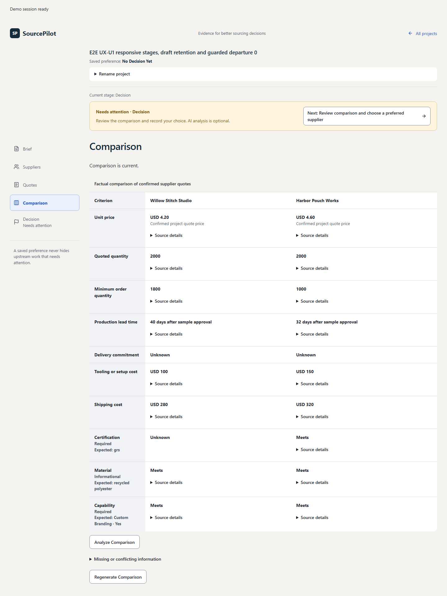
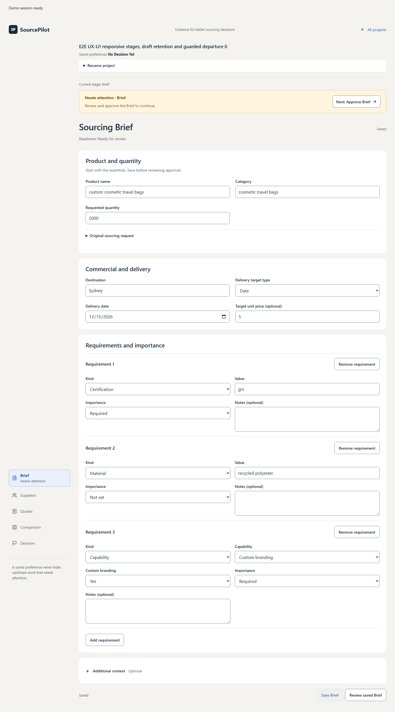
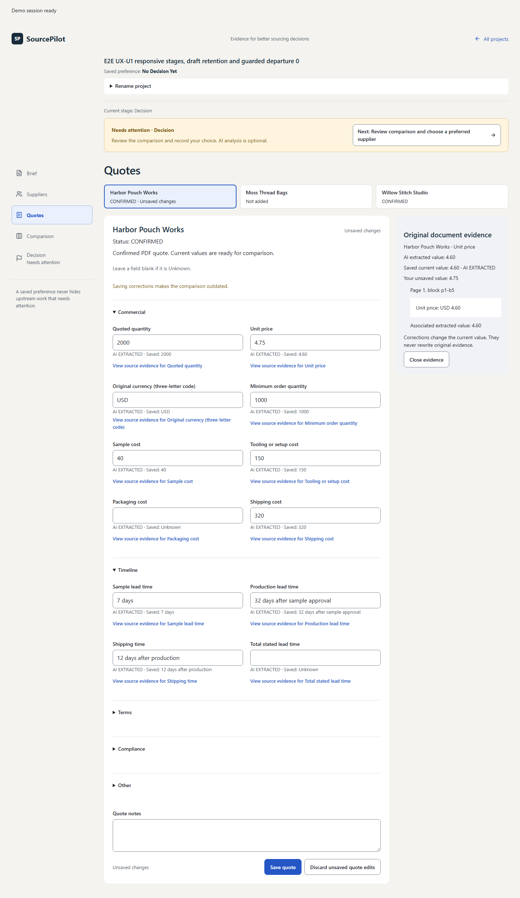
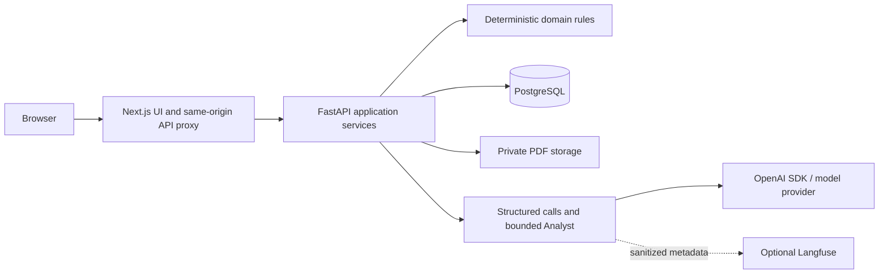

# SourcePilot

An AI-assisted supplier sourcing workspace for turning an incomplete product request and inconsistent supplier quotes into a reviewable decision. Define requirements, inspect supplier evidence, verify extracted quote data and compare tradeoffs before choosing a preferred supplier.

Small-business owners, founders, product managers and sourcing or operations specialists often start with an incomplete request, then receive quotes with different quantities, exclusions and delivery terms. A low unit price alone cannot show which offer fits. SourcePilot brings the requirements, supplier claims and reviewed quote facts into one workflow so the user can see the tradeoffs and make an informed choice.

**Brief → Suppliers → Quotes → Comparison → Decision**

This portfolio project is intended for local evaluation. Supplier names, capabilities, prices, evidence and quote fixtures are fictional; they make no claims about real manufacturers.



*Compare confirmed quote facts while keeping evidence and unknowns visible. Screenshots are real browser captures from the provider-free synthetic test flow on 10 November 2026; model responses use test doubles. They show selected working surfaces, not live-model quality or a full verification report. The example compares two confirmed quotes from a three-supplier shortlist.*

[Workflow](#how-it-works) · [AI engineering](#ai-engineering) · [Architecture](#architecture) · [Run locally](#run-locally) · [Tests and evals](#tests-and-evaluations) · [Limitations](#known-quality-and-ux-limitations)

## How it works

### 1. Define and approve the Brief

Start with a request such as “2,000 custom cosmetic travel bags made from recycled material, with our logo, for under USD 5 each.” Analyze the request, review the structured fields and clarify missing details. Set requirement importance and explicitly approve the saved Brief before discovering suppliers.

<details>
<summary>Screenshot: review the structured Brief</summary>



*The editor keeps requirements editable before approval. This automated scenario changes certification to Required; it is an example user choice, not a recommendation.*

</details>

### 2. Review suppliers and approve a shortlist

Discover candidates from the curated synthetic catalog. Inspect capabilities, requirement findings and available evidence; optionally request an AI explanation. Missing evidence stays **Unknown**, and contradictory information remains visible. You choose and approve a shortlist of up to three suppliers.

### 3. Add quotes and verify the data

Upload a text-extractable PDF or enter a quote manually. Review extracted values, source evidence, uncertainty and any corrections before explicitly confirming the quote. If a PDF cannot be processed, manual entry remains available.

<details>
<summary>Screenshot: compare an edit with the original PDF evidence</summary>



*The unsaved edit is 4.75; the saved and extracted price is still 4.60. Editing a project value never rewrites what the original document says.*

</details>

### 4. Compare facts and explore tradeoffs

With an approved shortlist and at least two confirmed quotes, generate the factual comparison. Review prices, quantities, requirement fit, source details and uncertainties. Optional AI analysis explains tradeoffs and may suggest a supplier or decline to suggest one. Failed analysis leaves the factual comparison available for review and retry.

### 5. Record your decision

Review the evidence, choose a supplier and explicitly **Mark as Preferred Supplier**. The saved preference records your decision. SourcePilot does not contact suppliers, negotiate, place orders or make payments.

For a complete synthetic example, follow the [manual demo walkthrough](docs/local-development.md#manual-demo-walkthrough), including failed-PDF recovery. The supplied PDFs name Manila in their shipping text while the example Brief requests Sydney; that mismatch is intentionally left visible for review.

## AI engineering

**Application code owns the workflow. AI interprets and explains. Humans approve.**

| Capability | How it works |
| --- | --- |
| Structured extraction | Brief and quote interpretation use schema-constrained model responses, Pydantic validation and application checks. Clarification wording follows deterministic readiness findings. |
| Evidence grounding | Supplier explanations use scoped evidence tools; PDF fields reference validated page/block IDs. Original evidence, extracted values, current values and user corrections remain distinct. |
| Uncertainty disclosure | Unknowns and conflicts remain explicit. Project-specific confirmed facts take precedence over general catalog data without treating different contexts as contradictions. |
| Deterministic rules | Application/domain code handles readiness, retrieval, supported requirement evaluation, arithmetic, currency/quantity checks, source resolution and workflow transitions. No numeric supplier match score is invented. |
| Human approvals | The user approves the Brief and shortlist, verifies quotes and chooses the preferred supplier. Model output cannot approve these transitions. |
| Bounded repair | Structured operations allow one validation repair and one retry for retryable provider failures. The Analyst also has turn/tool budgets; failures do not trigger an unlimited loop. |
| Recovery and freshness | PDF processing status is persisted, abandoned attempts can be retried, and upstream changes invalidate affected evaluations/comparisons. Stale advice is not treated as current. |
| Evaluation and tracing | Versioned synthetic cases, contract tests and negative controls distinguish exact assertions from heuristic signals and human judgment. PostgreSQL AI-run records retain model/prompt identity, validation, retries, timing and available usage. |

The **Sourcing Analyst** is the only agent. It chooses read-only tools within the current project and session, with defaults of **four model turns and six successful tool calls**. It cannot change records, approve anything or communicate externally. Brief interpretation, clarification and quote extraction are separate structured tasks.

Schema validity and valid citations do not prove narrative correctness. The [eval guide](apps/api/evals/README.md) explains what automated scoring can and cannot establish. [Optional Langfuse](docs/development/OBSERVABILITY.md) exports sanitized execution metadata on a best-effort basis; raw prompts, PDF text, model outputs and credentials are excluded from that export.

## Architecture

V1 is a modular monolith with application-owned workflow and PostgreSQL persistence.



| Area | Technology and role |
| --- | --- |
| Frontend | Next.js 15, React 19, TypeScript, Tailwind CSS 4; workflow UI and same-origin API proxy |
| Backend | Python 3.11, FastAPI, Pydantic, SQLAlchemy and Alembic; APIs, application services, domain rules and migrations |
| Persistence | PostgreSQL 16; project state, revisions, evidence and AI-run records |
| AI and documents | OpenAI SDK; structured outputs and read-only evidence tools. PyMuPDF for text/block extraction; private local storage with an S3-compatible adapter available |
| Quality | pytest, Vitest/Testing Library, Playwright, Ruff, Pyright, ESLint, TypeScript checks and GitHub Actions |
| Local tooling | Node.js 22, pnpm 10.30.1, uv and Docker Compose |

Manifests and lockfiles define dependency versions. Langfuse is optional, and local evaluation uses private local PDF storage by default.

The architecture deliberately stays small: the known workflow needs no top-level AI orchestrator or LangGraph; 15 structured synthetic supplier records need no vector database. PDF work runs in-process with persisted status and explicit recovery, without Redis/Celery or a durable worker queue. See the [architecture](docs/specs/SourcePilot-Technical-Architecture-v0.2.md) for provenance, staleness and these tradeoffs.

## Repository structure

```text
.
├── apps/web/
│   ├── app/                      # Next.js pages and same-origin API proxy
│   ├── components/               # Workflow UI and component tests
│   ├── lib/                      # Shared API access and frontend helpers
│   └── e2e/                      # Playwright workflow scenarios
├── apps/api/
│   ├── sourcepilot/              # API, application/domain modules, AI and persistence
│   ├── alembic/                  # Database migrations
│   ├── tests/                    # Automated tests, synthetic PDFs and regression fixtures
│   └── evals/                    # Versioned cases, offline outputs and evaluation guide
├── docs/
│   ├── specs/                    # Product specification, architecture and roadmap
│   ├── development/              # Workflow, coding standards and observability
│   └── local-development.md      # Setup, manual demo and detailed check prerequisites
├── scripts/                      # Local API launcher and browser-test support
└── .github/workflows/ci.yml      # Provider-free CI checks
```

Tests consume tracked fixtures and datasets; private development records are not build or test prerequisites. Generated reports, local configuration and uploaded documents stay outside the tracked tree.

Useful entry points are [the API routes](apps/api/sourcepilot/main.py), the backend's `briefs/`, `suppliers/`, `quotes/`, `comparison/` and `projects/` modules for workflow behavior, and `ai/` for structured tasks, Analyst tools and validation. [package.json](package.json) defines web/check entry points; [pyproject.toml](apps/api/pyproject.toml) defines API dependencies. [docker-compose.yml](docker-compose.yml) provisions local PostgreSQL; [scripts/dev-api.py](scripts/dev-api.py) launches the API with root environment settings. The [fixture guide](apps/api/tests/fixtures/quote_pdfs/README.md) explains the synthetic demo inputs.

## Run locally

Install Git, Node.js 22, **pnpm 10.30.1**, Python **3.11**, uv, and Docker with Compose and a running engine. Start with [clone and configuration](docs/local-development.md#clone-and-local-configuration), then follow [configure and start](docs/local-development.md#configure-and-start) for the complete sequence. Repository access is required to clone.

The normal development path is: copy the environment example, start PostgreSQL and wait for readiness, install locked dependencies, apply Alembic migrations, seed the synthetic supplier catalog, then start the API and web app in separate terminals. The guide supplies commands and working directories; database resets and browser-test provisioning are separate optional checks.

| Configuration | Local use |
| --- | --- |
| Root [`.env.example`](.env.example) → `.env` | Compose database settings and server-side application settings. `DATABASE_URL` must match the development database. The API launcher makes this file authoritative. |
| `OPENAI_API_KEY`, `SOURCEPILOT_AI_MODEL` | Leave blank for manual/deterministic features; set both for paid AI actions described below. |
| `DOCUMENT_STORAGE_BACKEND=local` | Default private PDF storage; no cloud credentials needed. See [storage settings](docs/local-development.md#local-pdf-storage). |
| Web [`.env.example`](apps/web/.env.example) → `.env.local` | Optional `API_ORIGIN` override when FastAPI is elsewhere; never store provider secrets here. |
| `TEST_DATABASE_URL` / `E2E_DATABASE_URL` | Separate disposable databases for optional tests; E2E setup is not ordinary startup. |

The examples also document session, upload and analysis limits. Optional [Langfuse](docs/development/OBSERVABILITY.md) and S3-compatible storage require their own configuration; external services may incur costs.

| Service | Default local address |
| --- | --- |
| Workspace | `http://localhost:3000` |
| API / interactive API docs | `http://localhost:8000` / `http://localhost:8000/docs` |
| Health | `http://localhost:8000/health` (does not check database connectivity) |
| PostgreSQL | Host port `5432` |

Compose's database port is not bound only to loopback. Its example credentials and topology are for a trusted local machine; do not expose them as a public service.

To shut down, press **Ctrl+C** in each API/web terminal, then run `docker compose stop postgres` from the root when the database is no longer needed. This preserves its volume and uploaded PDFs. See [shutdown and restart](docs/local-development.md#shutdown-and-restart) for details.

### Provider configuration and cost

Interactive AI actions require **`OPENAI_API_KEY`** and **`SOURCEPILOT_AI_MODEL`** in the server-side root `.env`. Choose a model available to your account that supports the application's structured-output and tool-calling requests; there is no default model. Restart the API after changes. Never put provider credentials in frontend configuration or Git.

Startup, manual editing and deterministic comparison do not require a model key. **Analyze request**, clarification, PDF extraction, supplier explanation and comparison analysis call the live provider and can incur charges. Retries, repairs and multiple Analyst turns can add usage; no fixed per-demo cost is guaranteed. Automated checks use doubles; the browser test model is not a general interactive demo mode. Optional tracing setup is separate.

For a provider-free manual walkthrough, create a project, fill and approve the Brief yourself, discover/approve the shortlist, enter and confirm quotes manually, generate the factual comparison and record a preference. Skip the AI actions and PDF extraction. Discovery uses the seeded catalog and deterministic rules.

## Tests and evaluations

Install the locked dependencies above first. Commands below are reproducible entry points, not a report of tests run for this documentation update.

| Working directory | Command | Purpose / prerequisites |
| --- | --- | --- |
| Repository root | `pnpm lint` / `pnpm typecheck` | Web lint and TypeScript checks |
| Repository root | `pnpm test` | Component/unit tests with Vitest |
| Repository root | `pnpm build` | Next.js production build; stop the dev server first because both use `.next` |
| `apps/api` | `uv run --no-sync ruff check .` / `uv run --no-sync pyright` | Backend lint and type checking |
| `apps/api` | `uv run --env-file ../../.env pytest` | Backend tests; integration coverage resets the guarded, separate `TEST_DATABASE_URL` database |
| `apps/api` | `uv run --no-sync python -m sourcepilot.ai.eval_baseline --mode offline --output .eval-results/offline` | Full offline eval baseline using tracked synthetic cases; no model-provider call |
| Repository root | `pnpm test:e2e` | Real web/API/PostgreSQL/PDF workflow with a test-only model; resets the separate `sourcepilot_e2e` database |

Read the [test/database safeguards](docs/local-development.md#migrations-and-persistence-tests) and [browser prerequisites](docs/local-development.md#deterministic-browser-workflow-m5-u3) before running database-backed commands. Use disposable databases, confirm resets are acceptable, and never run E2E invocations concurrently. Stop the development server before E2E builds share `.next` output. Keep raw traces and session data private.

[CI](.github/workflows/ci.yml) defines the automated commands. The [eval guide](apps/api/evals/README.md) covers categories, negative controls, scoring limits and separately opt-in live evaluation, which needs provider credentials and an already configured dedicated eval database. Offline regression success does not establish live-model quality; heuristic signals are not human review outcomes.

### Known quality and UX limitations

- **Demo scope:** curated synthetic suppliers only; no live research, supplier outreach, procurement execution, accounts or teams. No hosted demo or production-readiness claim is made; deployment and final release approval remain pending.
- **Quotes and delivery:** text-extractable PDFs only, with default limits of 10,000,000 bytes and 15 pages. No OCR, spreadsheet upload or automatic FX conversion. Current quote fields cannot record a structured dated delivery commitment; production lead time does not prove arrival by a target date.
- **AI quality:** extraction/correctness and Analyst factual-quality findings remain unresolved. A complete successful current-version live baseline and live-advice preservation browser verification are not established; human quality reviews remain pending. Validate outputs against their sources. Hosted Langfuse visibility is also unverified.
- **Sessions and drafts:** anonymous sessions default to a fixed 24-hour lifetime. Unsaved drafts survive stage/supplier switching in memory, but reload, expiry or process loss can discard them. Save each record explicitly.
- **UX validation:** screen-reader interoperability, actual 400% zoom and participant usability validation remain unverified; no accessibility-conformance claim is made.

## Engineering documentation

- [Product specification](docs/specs/SourcePilot-Product-Specification-v0.2.md), [technical architecture](docs/specs/SourcePilot-Technical-Architecture-v0.2.md) and [implementation roadmap](docs/specs/SourcePilot-Implementation-Plan-v0.2.md)
- [Local setup and synthetic walkthrough](docs/local-development.md), [evaluation guide](apps/api/evals/README.md) and [AI observability](docs/development/OBSERVABILITY.md)
- [Development workflow](docs/development/WORKFLOW.md), [coding standards](docs/development/CODING_STANDARDS.md) and [repository instructions](AGENTS.md)

Licensing is deferred. This repository currently includes no project license; no open-source license grant is claimed.
